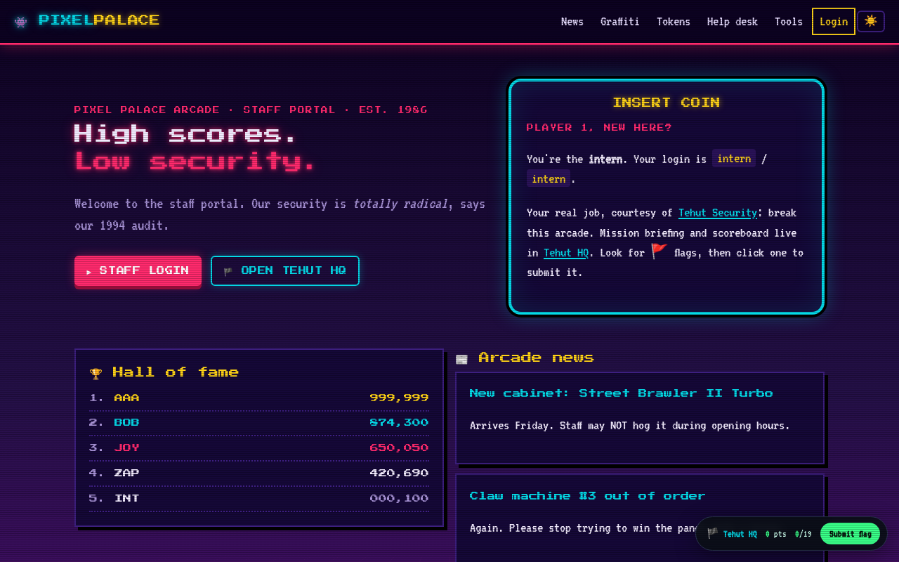
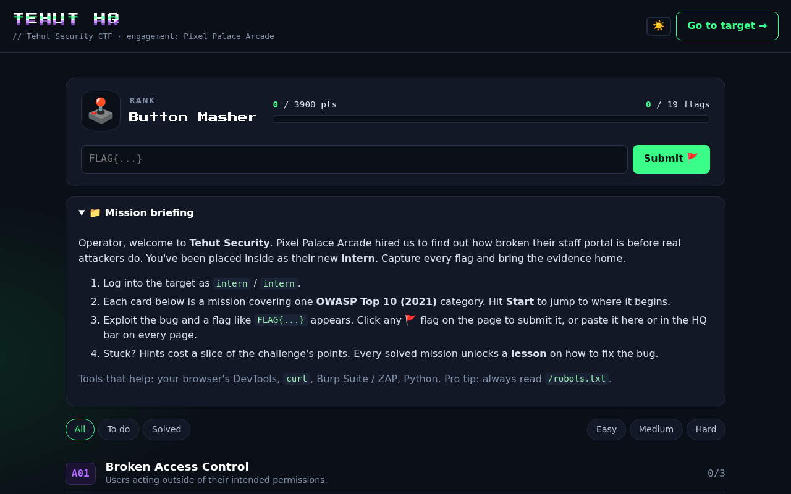
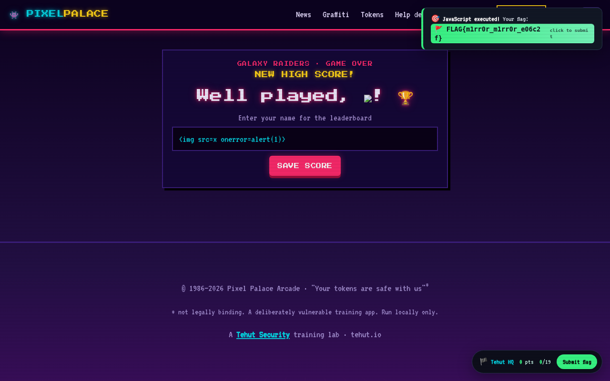
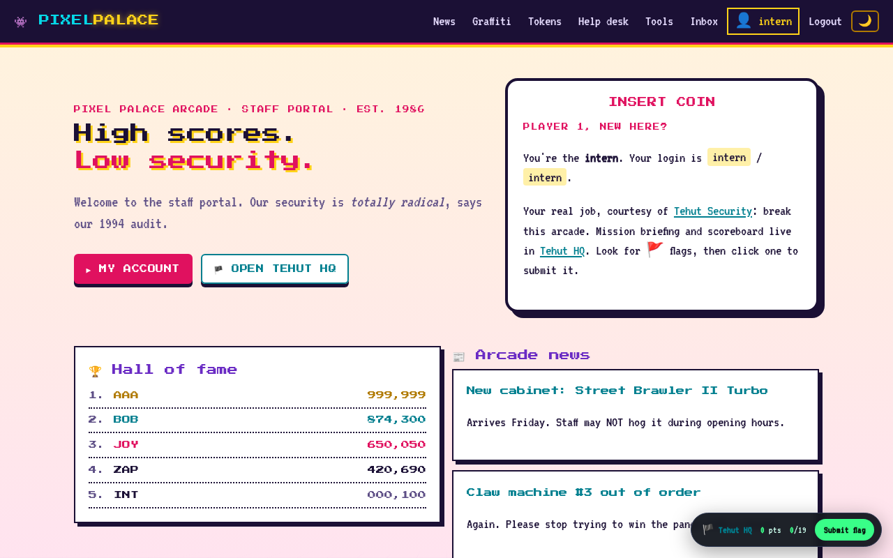

# 👾 Tehut Security CTF: Pixel Palace Arcade

[](https://github.com/tehut-io/tehut-ctf/actions/workflows/ci.yml)
-ff2a6d)


**Hack a (fake) 80s arcade. Learn the OWASP Top 10 by breaking things.**
A free training lab by **[Tehut Security](https://tehut.io)**.



Pixel Palace Arcade (est. 1986) runs its staff portal like it's still 1994: neon,
high scores and absolutely no security. Luckily, they hired **Tehut Security**, and
you're the operator placed inside as their new **intern**. Find out how broken the
place is before real attackers do.

- 🎯 **19 challenges** covering every OWASP Top 10 (2021) category, plus a secret bonus
- 🏴 **Tehut HQ**: mission board, scoreboard, ranks from *Button Masher* 🕹️ to *Pixel Palace's Final Boss* 👑
- 🚩 **Click-to-capture flags**: any flag that appears on a page turns into a button that submits it
- 💡 **Hints that cost points**: three per challenge, each more revealing than the last
- 🎓 **Lessons**: every solved challenge explains *why* it worked and *how to fix it*
- 🔀 **Unique flags per install**: reading the source on GitHub won't give you the answers
- 💾 **Progress is saved** between restarts
- 🌗 **Neon or daylight**: retro CRT look by default, with a light mode toggle

```
 You ──▶ Pixel Palace (the target)  ──▶  FLAG{...}  ──▶  🏴 Tehut HQ (score, hints, lessons)
```

| 🏴 Tehut HQ: missions, hints, score | 🚩 Pop a bug, click the flag |
|---|---|
|  |  |

Prefer daylight? Hit ☀️ in the top bar for the 90s light mode:



---

## ⚠️ Read this first

This app is **intentionally insecure**. Some challenges give you real **remote code
execution** on the machine running it.

- Run it **on your own machine, in Docker** (recommended) or in a throwaway VM.
- It binds to `127.0.0.1` only. **Never** expose it to a network or the internet.
- Built-in guard rails stop *other websites* from attacking your lab through your
  browser (cross-site requests and DNS rebinding are rejected).
- Only practise these techniques on systems you own or are allowed to test.

---

## 🚀 Quick start

### Option A: Docker (recommended)

```bash
git clone https://github.com/tehut-io/tehut-ctf.git
cd tehut-ctf
docker compose up --build
```

### Option B: Python 3.9+

```bash
./run.sh                     # creates a venv and starts the lab
# or
pip install -r requirements.txt && python3 app.py
```

Then open **http://127.0.0.1:5000** and log in as `intern` / `intern`.
Your mission briefing is in **Tehut HQ** at http://127.0.0.1:5000/hq.

> Linux, macOS and WSL work out of the box. On plain Windows, use Docker
> (one challenge expects a Unix shell).

---

## 🕹️ How to play

1. Open **Tehut HQ** (`/hq`) and pick a mission. **Start →** jumps to where it begins.
2. Poke at the arcade with your browser, DevTools, `curl`, Burp Suite/ZAP or Python.
3. When you exploit a bug, a flag like `FLAG{s0m3th1ng_a1b2c3}` appears.
   **Click it** to submit, or paste it into the HQ bar at the bottom-right of every page.
4. Stuck? Reveal a hint. Hints cost 10% / 20% / 30% of the challenge's points.
5. After solving, open **🎓 Lesson learned** on the card to see how to fix the bug.

**Tip:** for the XSS challenges, a plain `alert()` is enough. HQ notices when your
JavaScript runs.

### Challenges

| # | Category | Challenge | Difficulty | Points |
|---|---|---|---|---|
| 1 | A01 Broken Access Control | Nosy Neighbour | 🟢 easy | 100 |
| 2 | A01 Broken Access Control | Forgotten API | 🟢 easy | 150 |
| 3 | A01 Broken Access Control | Manager Clicks Everything | 🟡 medium | 250 |
| 4 | A02 Cryptographic Failures | Backup Blunder | 🟡 medium | 200 |
| 5 | A03 Injection | Union Station | 🟡 medium | 250 |
| 6 | A03 Injection | Mirror, Mirror | 🟢 easy | 100 |
| 7 | A03 Injection | Graffiti Wall | 🟡 medium | 200 |
| 8 | A03 Injection | Ping of Doom | 🟡 medium | 250 |
| 9 | A04 Insecure Design | Reset Roulette | 🟡 medium | 200 |
| 10 | A04 Insecure Design | Infinite Token Glitch | 🟢 easy | 150 |
| 11 | A05 Security Misconfiguration | Stack Trace Spill | 🟢 easy | 100 |
| 12 | A06 Vulnerable Components | Ancient Templates | 🟡 medium | 200 |
| 13 | A07 Auth Failures | Cookie Forgery | 🟡 medium | 200 |
| 14 | A07 Auth Failures | PIN Cracker | 🔴 hard | 300 |
| 15 | A08 Integrity Failures | Gold Membership | 🟢 easy | 150 |
| 16 | A08 Integrity Failures | Pickle Rick | 🔴 hard | 400 |
| 17 | A09 Logging Failures | Fake News Logs | 🔴 hard | 300 |
| 18 | A10 SSRF | Inside Job | 🔴 hard | 350 |
| 19 | ??? | *Secret* | 🟢 easy | 50 |

Suggested order for beginners: the easy ones first, then medium, then hard.

### Resetting

In HQ, at the bottom of the page:
- **♻️ Reset lab data** restores staff accounts, tokens, graffiti and logs. Your score is kept.
- **🧨 Wipe progress** starts over with brand-new flags.

With Docker, `docker compose down -v` deletes everything.

---

## 🧩 Project layout

```
app.py              the vulnerable arcade + Tehut HQ (look for "# VULN:" comments)
challenges.py       challenge stories, hints, lessons, points
templates/          base layout, HQ page, fake debugger page
static/             styling, pixel fonts + the game UI (flag chips, confetti, hints)
solutions/          SPOILERS: automated solver used by CI
SOLUTIONS.md        SPOILERS: written walkthrough
```

Try to play **black-box** first. Reading `app.py` is like reading the answer key.

## 🤝 Contributing a challenge

1. Add an entry to `CHALLENGES` in `challenges.py` (key, slug, story, 3 hints, lesson).
2. Add the vulnerable feature in `app.py` and show `flag("<your key>")` only when
   the bug is really exploited.
3. Add the solve to `solutions/solve_all.py`. CI fails if any challenge is unsolvable.
4. Open a pull request. 🎉

## 🔐 Security

This app is vulnerable **on purpose**. See [SECURITY.md](SECURITY.md) for what is in and out
of scope if you think you found a *real* problem (for example, a way around the localhost
guard rails).

## 📜 License

MIT. See [LICENSE](LICENSE). Pixel Palace Arcade is fictional; any resemblance to a real
company's security is, sadly, probably accurate. The bundled pixel fonts
(Press Start 2P, VT323) are under the SIL Open Font License; see `static/fonts/OFL.txt`.

---

<p align="center">Made with ☕, neon and questionable arcade security by <a href="https://tehut.io"><b>Tehut Security</b></a> · <a href="https://tehut.io">tehut.io</a></p>
# tehut-ctf
